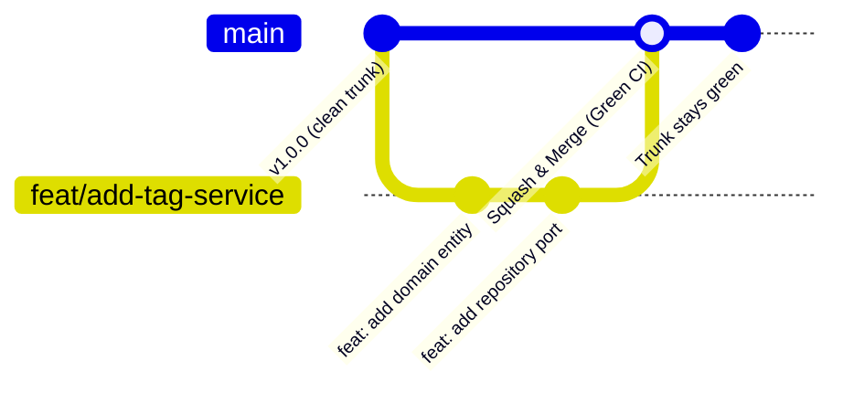

# DashNode — Arquitectura Git Trunk (Trunk-Based Development)

Este documento define la estrategia de branching, integración continua y disciplina de desarrollo adoptada para el repositorio `dashnode-backend`.

---

## 1. Visión General de Trunk-Based Development (TBD)

En lugar de utilizar modelos pesados de integración con ramas de larga duración (como GitFlow), **DashNode** adopta **Trunk-Based Development (TBD)**. 

En TBD:
- **`main` es el "Trunk" (tronco principal)**: Representa la única fuente de verdad y debe estar **siempre verde** (compilando, testeado y listo para desplegar en cualquier momento).
- **Integraciones frecuentes**: Todo el código nuevo se integra en `main` al menos una vez al día.
- **Ramas de vida ultra corta (*Short-Lived Feature Branches*)**: Cualquier rama secundaria tiene una vida máxima de **1 a 2 días** antes de fusionarse.
- **Tolerancia cero a ramas rotas (*Stop the Line*)**: Si el trunk se rompe, la prioridad absoluta de todo el equipo es arreglarlo de inmediato o hacer rollback del commit causante.

---

## 2. Tipos de Ramas y Convenciones de Nombres

| Tipo de Rama | Prefijo | Vida Máxima | Descripción |
|---|---|---|---|
| **Trunk** | `main` | Permanente | Rama de producción/despliegue continuo. Protegida. |
| **Feature** | `feat/<nombre-corto>` | 1 - 2 días | Nuevas funcionalidades o endpoints. |
| **Fix / Bug** | `fix/<nombre-corto>` | Horas - 1 día | Corrección de defectos o errores. |
| **Refactor** | `refactor/<nombre-corto>` | 1 día | Mejoras de código o reestructuración sin cambio funcional. |
| **Chore / Infra**| `chore/<nombre-corto>` | 1 día | Tareas de configuración, dependencias o tooling. |

> ⚠️ **Regla de Oro**: Nunca crear ramas como `develop`, `release/*` o ramas de feature que duren semanas.

---

## 3. Flujo de Trabajo Diario del Desarrollador



### Paso 1: Actualizar Trunk localmente
Antes de iniciar cualquier cambio:
```bash
git checkout main
git pull --rebase origin main
```

### Paso 2: Crear rama de vida corta
```bash
git checkout -b feat/task-filtering
```

### Paso 3: Desarrollar con commits atómicos (Conventional Commits)
Mantener commits pequeños, enfocados y con mensajes estándar:
- `feat(tasks): add status filter in query specification`
- `test(tasks): add unit tests for query filters`
- `refactor(projects): simplify membership validation`

### Paso 4: Validar localmente las Quality Gates
Antes de hacer push o abrir un Pull Request, ejecutar la verificación obligatoria:
```bash
# Ejecuta Ruff, Mypy, Import Linter y Pytest
make check
```
*(O a través de los hooks configurados en `.githooks/`)*.

### Paso 5: Abrir Pull Request hacia `main`
- El PR debe ser pequeño (**menos de 300-400 líneas modificadas**).
- Requiere que el flujo de GitHub Actions (`CI Quality Gate (Trunk)`) pase en verde al 100%.
- Requiere al menos 1 aprobación rápida de un compañero (revisión asíncrona prioritaria).

### Paso 6: Fusión hacia `main` (Squash & Merge o Rebase)
- Se utiliza preferentemente **Squash and Merge** o **Rebase and Merge** para mantener un historial lineal y limpio en `main`.
- La rama de la feature se elimina inmediatamente tras el merge.

---

## 4. Estrategia para Funcionalidades Grandes: *Feature Flags* y *Branch by Abstraction*

Para evitar ramas de larga duración cuando una funcionalidad requiere varios días o semanas de trabajo:

1. **Branch by Abstraction (Puertos y Adaptadores)**:
   - Crear el puerto (interfaz) y la implementación inicial.
   - Integrar la abstracción en `main` sin activar la llamada final.
2. **Feature Flags**:
   - Encapsular la nueva funcionalidad detrás de un condicional de configuración (`settings.ENABLE_ADVANCED_FILTERS = False`).
   - El código se integra continuamente en `main` y corre los tests sin afectar a los usuarios en producción.
   - Una vez completa y validada, se activa el flag y se limpia el código antiguo.

---

## 5. Configuración de Protección de Ramas en GitHub

Para garantizar la estabilidad del Trunk, la rama `main` en GitHub debe tener configuradas las siguientes reglas:

1. **Require a pull request before merging**:
   - `Require approvals`: 1 revisión.
   - `Dismiss stale pull request approvals when new commits are pushed`: Activado.
2. **Require status checks to pass before merging**:
   - Estado requerido: `Verify Quality Gates` (del workflow `trunk-ci.yml`).
   - `Require branches to be up to date before merging`: Activado.
3. **Require linear history**:
   - Evita "merge bubbles" y preserva el historial limpio.
4. **Do not allow bypassing the above settings**:
   - Aplica incluso para administradores.

---

## 6. Instalación de Hooks Locales (Pre-commit)

Para validar automáticamente antes de cada `git commit`:
```bash
# En Windows (PowerShell):
.\scripts\setup-hooks.ps1

# En Linux / macOS / Bash:
bash scripts/setup-hooks.sh
```

Esto ejecuta automáticamente `ruff`, `mypy`, `import-linter` y `pytest` antes de permitir que un commit sea creado localmente.
